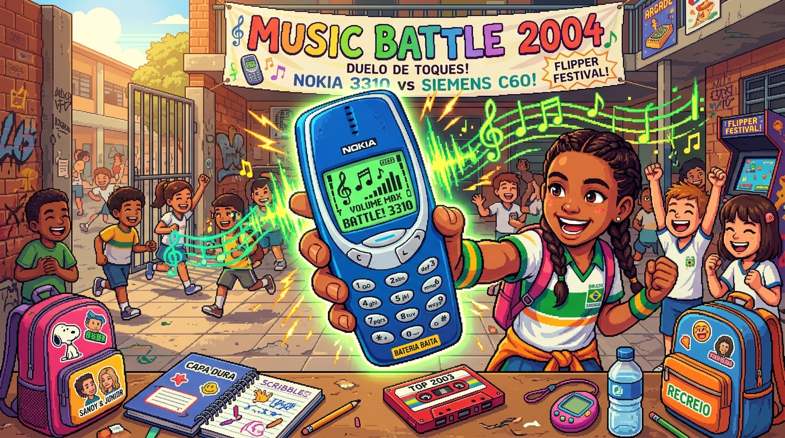

# 📱 Toque de Guerra

<p align="center">
  
</p>

<p align="center">
  <a href="https://github.com/leonardoconstantino/toque-de-guerra/actions/workflows/deploy.yml">
    
  </a>
  <a href="https://leonardoconstantino.github.io/toque-de-guerra/">
    
  </a>
  
  
  
  
  
</p>

---

### 🕹️ [👉 CLIQUE AQUI PARA JOGAR EM PRODUÇÃO NO GITHUB PAGES 👈](https://leonardoconstantino.github.io/toque-de-guerra/)

> **Ano 2004.** O sinal do recreio toca. As mochilas são jogadas no chão de cimento e o pátio da escola vira uma arena. Munido de um celular tijolão clássico e seu fiel caderno de códigos espiral, você precisa compor os melhores ringtones monofônicos, desafiar os rivais do recreio e manter sua bateria viva para ser coroado a lenda sonora do colégio!

---

## 🌟 Principais Recursos

- **Teclado Compositor Autêntico (Estilo Nokia 3310)**:
  - Sistema de notação e gramática musical dos celulares clássicos (teclas `1` a `7` para notas Dó a Si, `8`/`9` para alternar duração, `*` para subir oitava, `0` para pausas).
  - Feedback sonoro imediato a cada tecla digitada com síntese monofônica retrô via Web Audio API pura.
- **Duelos Roguelite no Pátio**:
  - Enfrente rivais icônicos da escola (Betinho do GameBoy, Vanessa do Pop, Juninho do Pagode, Mariana Rockeira, e outros).
  - Cada rival exige critérios sonoros específicos (tempo, andamento, densidade de notas e complexidade rítmica).
- **Gerenciamento de Recursos (Bateria & Moral)**:
  - Cada nota composta e teste de áudio consome preciosa porcentagem da sua bateria. Se chegar a 0%, o celular apaga!
- **Caderno de Códigos Secreto (Capa Dura & Espiral)**:
  - Desbloqueie páginas com cifras clássicas de revistas dos anos 2000 (*Missão Impossível*, *Axel F*, *Für Elise*, *Smoke on the Water*, etc.).
  - Filtro por categorias: Hits Nacionais, Games Retrô, Temas de Cinema e Clássicos de Ouro.
- **Os 7 Slots de Memória Permanente**:
  - Armazene até 7 composições no aparelho para usar nos duelos e levar até a vitória.
- **Modo Freestyle Pós-Vitória**:
  - Ao vencer um duelo, entre em modo livre para improvisar e gravar seu hit no pátio.
- **Rádio do Pátio FM 104.5**:
  - Ouça as composições dos rivais e suas próprias faixas em um player retrô integrado.
- **Laboratório de Treino (Bateria Infinita ∞)**:
  - Pratique e crie suas músicas livremente sem custo de bateria.
- **Eventos Aleatórios do Recreio**:
  - Trocas de figurinhas, inspeções do inspetor de alunos, emprestar o carregador ou dividir lanche na cantina, impactando sua jornada com escolhas táticas.
- **Interface Responsiva & Háptica**:
  - Layout totalmente adaptativo com rolagem fluida em mobile, tablets e desktops.

---

## 🎹 Como Jogar & Guia de Controles

### Regras de Composição Monofônica

| Tecla | Nota / Função | Descrição |
|:---:|:---:|:---|
| **1** | **C** (Dó) | Insere nota C |
| **2** | **D** (Ré) | Insere nota D |
| **3** | **E** (Mi) | Insere nota E |
| **4** | **F** (Fá) | Insere nota F |
| **5** | **G** (Sol) | Insere nota G |
| **6** | **A** (Lá) | Insere nota A |
| **7** | **B** (Si) | Insere nota B |
| **8** | **Diminuir Duração** | Reduz o tempo da nota atual (ex: semínima `4` ➔ semicolcheia `16`) |
| **9** | **Aumentar Duração** | Aumenta o tempo da nota atual |
| **\*** | **Oitava (+)** | Eleva a oitava da nota (Oitavas 4, 5 e 6) |
| **0** | **Pausa (—)** | Insere silêncio musical de compasso |
| **C / Backspace** | **Apagar** | Remove a última nota inserida |
| **Tocar (Play)** | **Ouvir** | Toca a partitura no sintetizador (consome 1% de bateria) |
| **Duelo** | **Batalhar** | Apresenta a melodia ao rival para avaliação |

> 💡 *Dica:* No teclado do computador, você também pode usar os números `1` a `7`, `Backspace` e `Espaço` diretamente!

---

## 🛠️ Tecnologias Utilizadas

- **[React 19](https://react.dev/)**: Biblioteca componentizada moderna com hooks reativos.
- **[Vite 6](https://vite.dev/)**: Bundler ultrarrápido com configuração de base dinâmica para GitHub Pages.
- **[TypeScript](https://www.typescriptlang.org/)**: Tipagem estática rigorosa para estruturas musicais e dados de jogo.
- **[Tailwind CSS v4](https://tailwindcss.com/)**: Estilização utilitária de alto desempenho sem overhead.
- **[Web Audio API](https://developer.mozilla.org/pt-BR/docs/Web/API/Web_Audio_API)**: Síntese de áudio nativa no navegador sem dependências pesadas externas.
- **[Lucide React](https://lucide.dev/)**: Ícones elegantes e otimizados.

---

## 🚀 Como Executar Localmente

### Pré-requisitos
- [Node.js](https://nodejs.org/) versão 18 ou superior instalado.
- Gerenciador de pacotes `npm` (ou `pnpm` / `yarn`).

### Passo a Passo

1. **Clone o repositório:**
   ```bash
   git clone https://github.com/leonardoconstantino/toque-de-guerra.git
   cd toque-de-guerra
   ```

2. **Instale as dependências:**
   ```bash
   npm install
   ```

3. **Inicie o servidor de desenvolvimento:**
   ```bash
   npm run dev
   ```
   Abra no seu navegador o endereço indicado (geralmente [http://localhost:3000](http://localhost:3000) ou [http://localhost:5173](http://localhost:5173)).

4. **Gerar build de produção para teste local:**
   ```bash
   npm run build
   npm run preview
   ```

---

## 🔄 Deploy Contínuo no GitHub Pages

Este repositório está configurado com um pipeline de Integração e Entrega Contínua (CI/CD) automatizado via **GitHub Actions** em `.github/workflows/deploy.yml`.

### Como Funciona:
1. Ao realizar um `push` ou `merge` para a branch `main` ou `master`, o workflow é iniciado automaticamente.
2. O ambiente instala as dependências com Node.js 20 e compila a aplicação com a variável `GITHUB_ACTIONS=true`, aplicando o subcaminho `/toque-de-guerra/` dinamicamente no `vite.config.ts`.
3. Os artefatos estáticos da pasta `dist/` são publicados na infraestrutura segura do **GitHub Pages**.

### Configuração Inicial Necessária no GitHub:
Para habilitar a publicação na sua conta do GitHub:
1. Acesse o seu repositório no GitHub: `https://github.com/leonardoconstantino/toque-de-guerra`.
2. Vá em **Settings** ➔ aba lateral **Pages**.
3. Na seção **Build and deployment**:
   - Em **Source**, selecione **GitHub Actions**.
4. Faça o push do código. O deploy ocorrerá em poucos segundos e o jogo estará disponível em:
   👉 **https://leonardoconstantino.github.io/toque-de-guerra/**

---

## 📄 Licença

Distribuído sob a licença **MIT**. Consulte `LICENSE` para mais informações.
